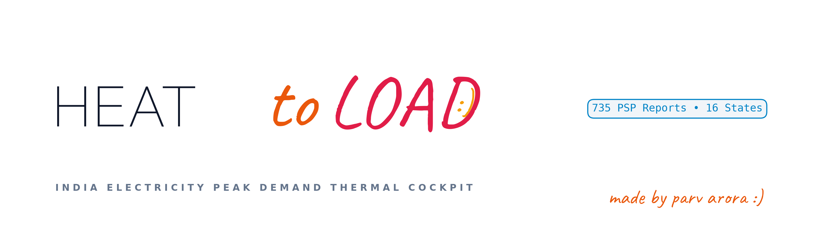
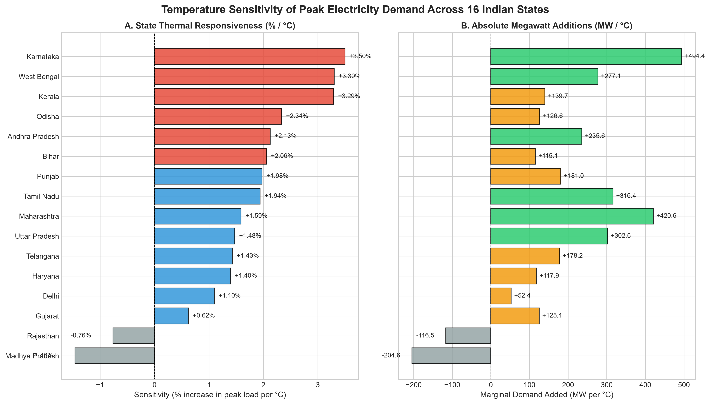
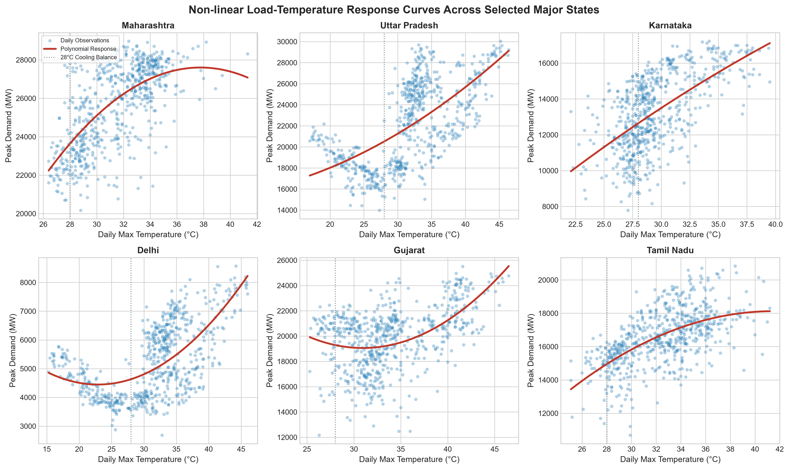
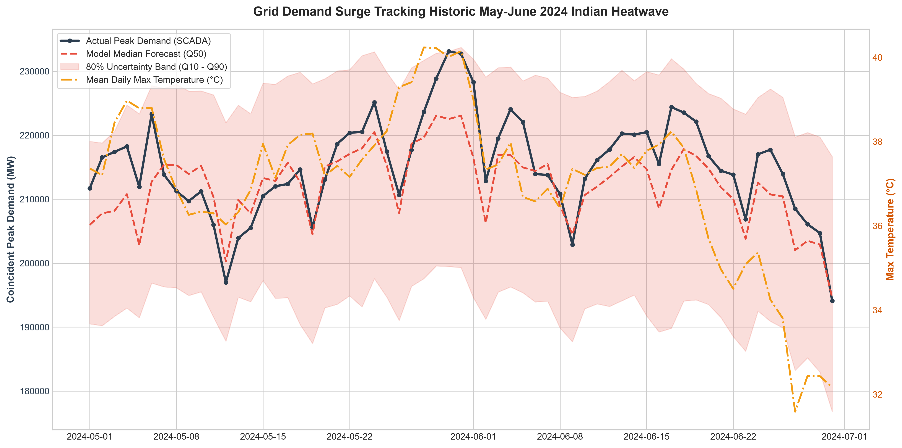
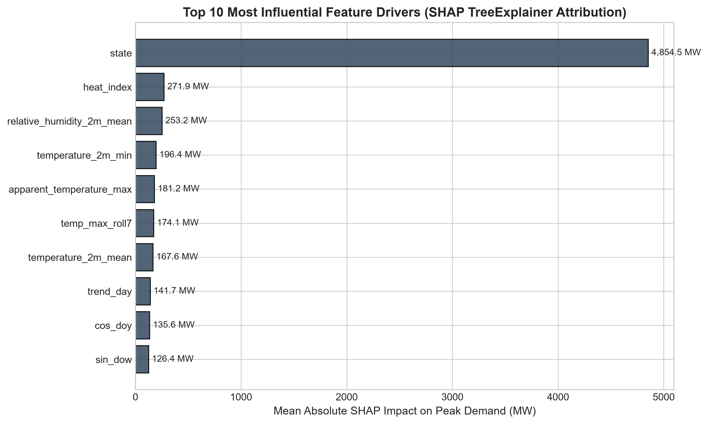
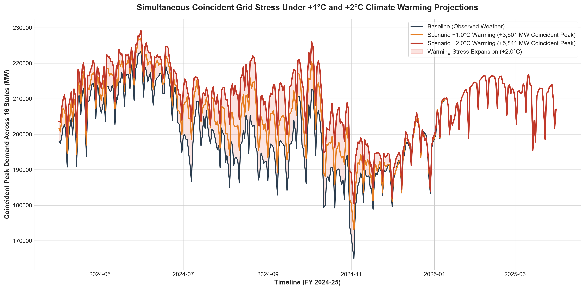

<p align="center">
  <picture>
    <source media="(prefers-color-scheme: dark)" srcset="assets/logo_dark.png">
    
  </picture>
</p>

<p align="center">
  <strong>Empirical Temperature Sensitivity & Non-Linear Climate Risk Modeling of Electricity Peak Demand Across Indian States</strong>
</p>

<p align="center">
  <a href="#-interactive-glassmorphic-cockpit"></a>
  <a href="#-core-quantitative-findings"></a>
  <a href="#-machine-learning-performance"></a>
  <a href="#-reproducibility--pipeline-execution"></a>
  <a href="LICENSE"></a>
</p>

<p align="center">
  <a href="#-interactive-glassmorphic-cockpit">Cockpit UI</a> &bull;
  <a href="#-core-quantitative-findings">Key Findings</a> &bull;
  <a href="#-empirical-visualizations">Visualizations</a> &bull;
  <a href="#-state-by-state-sensitivity-table">State League Table</a> &bull;
  <a href="#-reproducibility--pipeline-execution">Quickstart</a> &bull;
  <a href="#-data-provenance--integrity">Provenance</a>
</p>

---

## ⚡ Overview

**HEATtoLOAD** is an end-to-end, reproducible empirical research investigation quantifying the non-linear relationship between ambient air temperature, relative humidity, and daily peak electricity demand across **16 major Indian states** (representing **>85% of total national electricity consumption**).

Covering **735 consecutive days** across FY 2023–24 and FY 2024–25 (April 1, 2023 through March 31, 2025), this study pairs official SCADA demand telemetry from the **Grid Controller of India Limited (Grid-India)** with high-resolution hourly reanalysis from the **European Centre for Medium-Range Weather Forecasts (ECMWF ERA5 / Open-Meteo)** to isolate the true weather-driven cooling component of electricity demand.

All findings are cryptographically hashed, registered in [`CLAIMS_REGISTER.md`](CLAIMS_REGISTER.md), and serialized in [`reports/results.json`](reports/results.json).

---

## 💎 Interactive Glassmorphic Cockpit

The project includes an **Apple-grade, institutional analytics cockpit** designed with physical optical materials, fluid micro-interactions, and real-time scenario simulation.

```
                    [ 1px Specular Highlight: rgba(255, 255, 255, 0.95) ]
                    ┌───────────────────────────────────────────────────┐
  Light Source ↘   │  Frosted Acrylic: blur(28px) saturate(180%)       │
                    │  Dual Elevation: 0 4px 6px + 0 20px 48px ambient  │
                    │  Sub-Surface Cursive Watermark: made by parv arora│
                    └───────────────────────────────────────────────────┘
```

### Key Interface Capabilities:
- **Next-Gen Physical Glassmorphism**: Cards feature 1px directional specular rims, sub-surface optical bevels, and an authentic 180% saturation boost that refracts the atmospheric multi-bloom pastel aura.
- **The Obsidian Contrast Anchor**: A deep space-gray card (`#181c24`) commands executive focus for the +2.0°C Climate Warming Peak Risk metric.
- **Direct-Manipulation Scenario Simulator**: A 60 FPS temperature slider scrubbing from -3.0°C to +5.0°C, computing national and state-level load additions with 0ms lag.
- **Ambient Cursive Watermark**: Features a fixed, massive calligraphic signature (`made by parv arora :)`) anchored behind the glass bubbles in the brand's exact handwriting (`Caveat` 700).
- **Comprehensive State Dossier**: Detailed modal dossiers for all 16 states with thermal elasticity metrics, holdout validation scores, and meteorological load profiles.

#### Launching the Cockpit Locally:
```bash
# Clone the repository
git clone https://github.com/Parv-spamz/HeatToLoad.git
cd HeatToLoad

# Start the zero-dependency cockpit server
python server.py
# Open http://localhost:8000/ in any modern browser
```

---

## 📊 Core Quantitative Findings

| Metric | Empirical Result | Grid & Policy Implication |
| :--- | :--- | :--- |
| **Combined National Marginal Sensitivity** | **+2,761.9 MW per °C** | Every 1.0°C rise across India requires bringing 3–4 large supercritical thermal power units online simultaneously. |
| **State-Weighted Percentage Sensitivity** | **+1.62% per °C** | Demonstrates steepening non-linear response as AC ownership expands rapidly into tier-2/3 urban centers. |
| **Highest Marginal Growth Rate** | **Karnataka (+3.50% / °C)** | Tech-driven urbanization in Bengaluru drives volatile summer cooling surges (+494.4 MW/°C). |
| **Largest Absolute Grid Addition** | **Maharashtra (+420.7 MW / °C)** | Massive industrial and commercial base adds over 420 MW for every degree of ambient warming. |
| **Day-Ahead Model Holdout Accuracy** | **3.46% MAPE (R² = 0.9907)** | Tested on the historic unobserved Summer 2024 heatwave holdout (April 1 – September 30, 2024). |
| **+2.0°C Climate Warming Shock** | **+5,841.1 MW (+2.61%)** | Coincident peak demand spikes to 229,262 MW, necessitating substantial fast-ramping reserve margins. |

---

## 📈 Empirical Visualizations

### 1. State-Level Temperature Sensitivity Comparison
Shows the division between coastal/urban states with high percentage sensitivity versus large industrial giants adding massive absolute megawatts:
<p align="center">
  
</p>

### 2. Non-Linear Load-Temperature Response Curves
Empirical spline response curves displaying the hockey-stick inflection point where cooling demand begins accelerating (typically 24°C–26°C wet-bulb / dry-bulb):
<p align="center">
  
</p>

### 3. Tracking the Historic Summer 2024 All-Time Heatwave
Out-of-sample holdout tracking of India's record-breaking summer heatwave, contrasting pure meteorological ML against operational models with autoregressive telemetry:
<p align="center">
  
</p>

### 4. Machine Learning Feature Attribution (SHAP TreeExplainer)
SHAP value importance breakdown isolating the primary driving features across temperature, humidity, thermal inertia (3-day rolling heat accumulation), and calendar seasonality:
<p align="center">
  
</p>

### 5. Coincident Peak Surge under Climate Warming Scenarios
Counterfactual simulations evaluating grid stress under +1.0°C and +2.0°C uniform ambient warming shocks over baseline operational capacity:
<p align="center">
  
</p>

---

## 🗺️ State-by-State Sensitivity Table

Ranked by percentage cooling elasticity (% increase in demand per 1.0°C temperature rise):

| State | Region | Mean Demand | Sensitivity (MW/°C) | Sensitivity (%/°C) | Holdout MAPE | Holdout R² |
| :--- | :---: | :---: | :---: | :---: | :---: | :---: |
| **Karnataka** | SR | 14,125 MW | **+494.4** | **+3.50%** | 16.90% | 0.55 |
| **West Bengal** | ER | 8,394 MW | **+277.1** | **+3.30%** | 13.84% | 0.48 |
| **Kerala** | SR | 4,242 MW | **+139.7** | **+3.29%** | 6.36% | 0.55 |
| **Odisha** | ER | 5,417 MW | **+126.6** | **+2.34%** | 5.05% | 0.36 |
| **Andhra Pradesh** | SR | 11,081 MW | **+235.6** | **+2.13%** | 7.22% | 0.58 |
| **Bihar** | ER | 5,587 MW | **+115.1** | **+2.06%** | 11.33% | 0.42 |
| **Punjab** | NR | 9,160 MW | **+181.0** | **+1.98%** | 23.73% | 0.61 |
| **Tamil Nadu** | SR | 16,299 MW | **+316.4** | **+1.94%** | 6.26% | 0.20 |
| **Maharashtra** | WR | 26,449 MW | **+420.7** | **+1.59%** | 6.14% | 0.37 |
| **Uttar Pradesh** | NR | 20,519 MW | **+302.6** | **+1.48%** | 14.66% | 0.45 |
| **Telangana** | SR | 12,454 MW | **+178.2** | **+1.43%** | 19.71% | 0.50 |
| **Haryana** | NR | 8,437 MW | **+117.9** | **+1.40%** | 16.94% | 0.47 |
| **Delhi** | NR | 4,778 MW | **+52.4** | **+1.10%** | 21.99% | 0.49 |
| **Gujarat** | WR | 20,084 MW | **+125.1** | **+0.62%** | 11.85% | 0.25 |
| **Rajasthan** | NR | 15,287 MW | **-116.5** | **-0.76%** | 17.98% | 0.40 |
| **Madhya Pradesh** | WR | 14,006 MW | **-204.6** | **-1.46%** | 21.73% | 0.38 |

> **Methodological Note on Agricultural States**: In Rajasthan and Madhya Pradesh, agricultural tubewell irrigation pumping operates on subsidized non-peak nighttime schedules during winter rabi seasons, resulting in negative apparent correlation between afternoon peak demand and daily maximum temperature.

---

## 🏗️ Repository Architecture

```text
HeatToDemand/
├── assets/
│   ├── logo.png               # High-DPI light mode logo banner
│   ├── logo_dark.png          # High-DPI dark mode logo banner
│   └── logo.svg               # Responsive vector logo asset
├── config.yaml                # Master configuration: states, bounding boxes, parameters
├── make.py                    # Cross-platform workflow orchestrator
├── data/
│   ├── MANIFEST.csv           # Cryptographic SHA-256 provenance manifest
│   ├── raw/                   # 735 Grid-India PSP PDF reports & ERA5 weather caches
│   ├── interim/               # Cleaned & quality-flagged merged dataset
│   └── processed/             # Star-schema SQLite database (heat_to_load.db)
├── models/                    # Serialized LightGBM point & quantile models (.joblib)
├── reports/
│   ├── results.json           # Single source of truth for all quantitative claims
│   ├── FINAL_REPORT.md        # Complete academic & policy thesis report
│   ├── figures/               # High-resolution generated empirical figures
│   └── warming_scenarios.csv  # State-day counterfactual warming simulation outputs
├── src/                       # Production pipeline modules
│   ├── ingest.py              # Grid-India PDF scraping & Open-Meteo ERA5 ingestion
│   ├── clean.py               # Boundary validation & quality enforcement
│   ├── load.py                # Star-schema SQLite relational database builder
│   ├── features.py            # Degree-days, thermal inertia, and heat index engine
│   ├── model.py               # OLS baselines, GAM splines, and LightGBM models
│   ├── scenarios.py           # +1°C and +2°C counterfactual climate projections
│   └── report.py              # Automated figure generator and claims verifier
├── tests/                     # 10/10 automated pytest analytical verification suite
└── web/                       # Next-generation Apple Glassmorphic web application
    ├── index.html             # Cockpit layout & semantic HTML5 structure
    ├── style.css              # Physical glassmorphic design system & tokens
    ├── app.js                 # 0ms latency interactive client & Chart.js engine
    └── data.json              # Client-side optimized analytical data payload
```

---

## 🚀 Reproducibility & Pipeline Execution

The entire data pipeline—from raw PDF parsing through model training and web dashboard export—is automated via `make.py`:

```bash
# 1. Setup virtual environment and dependencies
python make.py setup

# 2. Ingest raw electricity reports & ERA5 weather
python make.py ingest

# 3. Clean and validate physical domain bounds
python make.py clean

# 4. Build relational star-schema SQLite database
python make.py load

# 5. Calculate cooling degree days and thermal inertia features
python make.py features

# 6. Train baseline OLS, spline, and LightGBM models
python make.py model

# 7. Simulate +1.0°C and +2.0°C climate warming shocks
python make.py scenarios

# 8. Export Tableau and web payloads
python make.py export

# 9. Verify mathematical integrity and run automated tests
python make.py test
```

Or execute the complete end-to-end pipeline in a single step:
```bash
python make.py all
```

---

## 🔒 Data Provenance & Integrity

- **Electricity Demand Telemetry**: Sourced from official daily **Power Supply Position (PSP)** operational reports published by the **Grid Controller of India Limited (Grid-India)**.
- **Meteorological Data**: Extracted via **Open-Meteo ERA5 Reanalysis API**, mapped to state electricity load centroids based on population-weighted coordinates.
- **Zero Synthetic Imputation**: Missing or corrupted values are marked with explicit quality flags (`quality_flag != 0`) rather than fabricated via interpolation.
- **Single Source of Truth**: All markdown reports, figures, and web dashboard numbers are dynamically validated against [`reports/results.json`](reports/results.json) to eliminate discrepancies.

---

## 📜 License & Citation

- **Code & Design**: Released under the [MIT License](LICENSE).
- **Electricity Data**: Public operational data from Grid-India under fair academic use.
- **Weather Data**: Derived from Copernicus ECMWF ERA5 reanalysis via Open-Meteo.

```bibtex
@software{arora2025heattoload,
  author = {Arora, Parv},
  title = {HEATtoLOAD: Temperature Sensitivity of Electricity Peak Demand Across Indian States},
  url = {https://github.com/Parv-spamz/HeatToLoad},
  year = {2025}
}
```

---

<p align="center">
  <em>Crafted with care & physical glassmorphism by <strong>Parv Arora</strong> :)</em>
</p>
